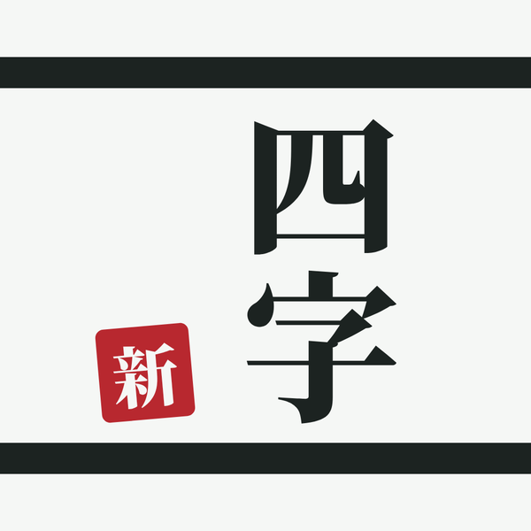
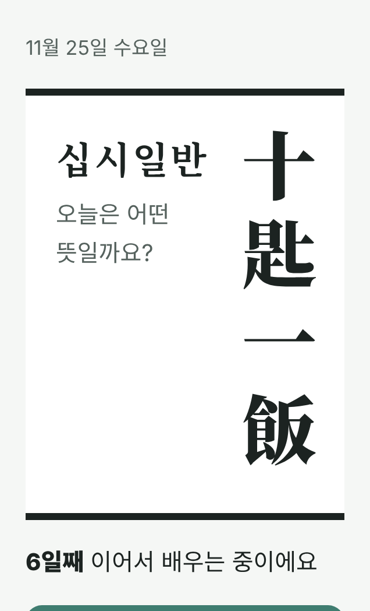
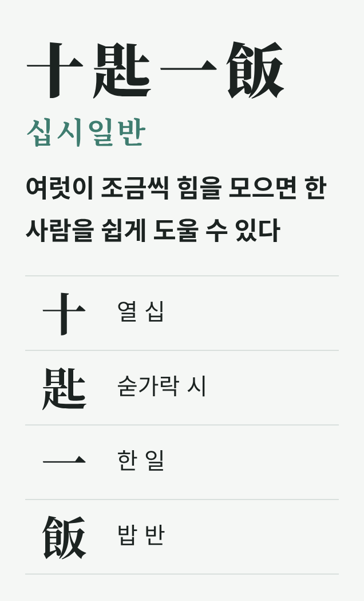
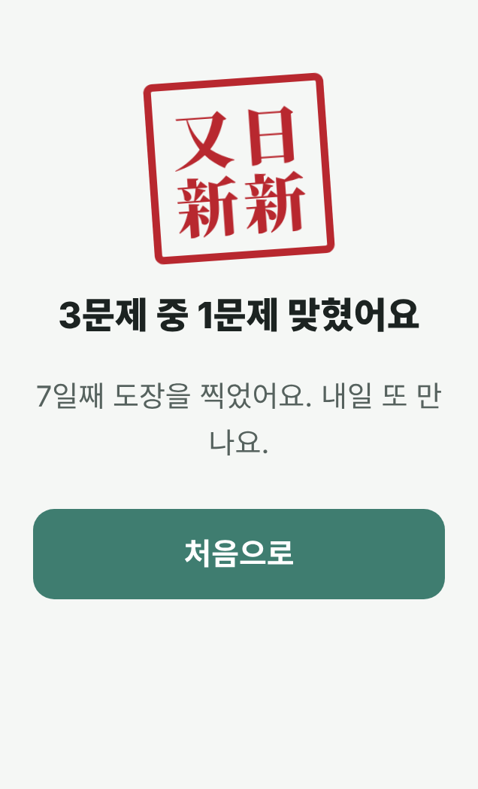

<p align="center">
  
</p>

<h1 align="center">toss-miniapps</h1>

<p align="center">
  토스 안에서 열리는 작은 앱들을 혼자 만들고 운영하는 저장소<br />
  <sub>앱인토스 WebView SDK · React · TypeScript · pnpm workspace</sub>
</p>

---

## 진열장

| | 서비스 | 한 줄 소개 | 상태 |
| :-: | --- | --- | --- |
|  | **하루 한 사자성어** <br /><sub>`apps/saja`</sub> | 5060을 위한 하루 1분 사자성어. 배우고, 퀴즈 풀고, 낙관을 찍는다 | 출시 준비 |
| 🛠 | **SI 개발자 키우기** <br /><sub>`apps/dev-idle`</sub> | 인턴에서 CTO까지, 야근·감리·장애를 버티는 방치형 게임 | MVP 개발 중 |

<p align="center">
  
  
  
</p>
<p align="center"><sub>오늘의 사자성어 족자 → 글자 풀이 → 공부를 마치면 찍히는 日新又新 낙관</sub></p>

## 온고지신 · 저장소 구조

```
toss-miniapps/
├─ apps/
│  ├─ saja/              하루 한 사자성어 (appName: daily-sajaseongeo)
│  └─ dev-idle/          SI 개발자 키우기 (appName: si-dev-idle, 등록 전)
├─ content/saja/         사자성어 원고 JSON — 한자, 훈음, 뜻, 이야기, 예문
├─ docs/
│  ├─ saja-console.md    콘솔 등록 문구, 푸시 템플릿, 광고 그룹
│  └─ assets/            아이콘, 콘솔용 스크린샷
├─ tools/                밸런스 시뮬레이터 등 (예정)
└─ server/               필요해질 때만 (지금은 서버 없음)
```

## 유비무환 · 실행하기

```sh
pnpm install
pnpm dev:saja                 # 로컬 개발 서버 (광고·알림은 테스트 모드)
pnpm --filter saja test       # 날짜·연속 출석·퀴즈·원고 형식 검사
pnpm build:saja               # dist/ + daily-sajaseongeo.ait → 콘솔에 업로드
```

- 실제 광고 ID와 푸시 템플릿 코드는 `apps/saja/.env.production`에만 넣는다. 개발 중에는 비워두면 테스트 광고 ID가 쓰인다.
- 광고는 샌드박스에서 나오지 않는다. 콘솔 QR 코드로 실기기에서 확인한다.

## 사필귀정 · 지키는 원칙

1. **서버는 필요할 때까지 만들지 않는다.** 진행 기록은 토스 Storage, 매일 알림은 콘솔 반복 발송으로 해결한다.
2. **원고는 직접 쓴다.** 사자성어 풀이와 예문은 다른 사전·앱의 문장을 옮기지 않는다. 형식은 테스트가, 내용은 사람이 검수한다.
3. **광고는 흐름을 끊지 않는다.** 전면 광고는 쓰지 않고, 리워드는 원할 때만, 배너는 스크롤되는 화면 본문에만 둔다.
4. **5060이 읽기 편해야 한다.** 본문 19px 이상, 터치 영역 56px 이상, 뒤로 가기는 토스 기본 버튼 하나로.

## 일취월장 · 다음 할 일

- [x] 사자성어 MVP, 디자인(족자·낙관), 광고·알림 연동, 아이콘
- [ ] 광고 그룹 ID·푸시 템플릿 코드 연결 후 실기기 테스트
- [ ] 사자성어 180개 (6개월분)까지 원고 추가
- [ ] 하루 한 사자성어 출시
- [ ] SI 개발자 키우기 개발 시작
